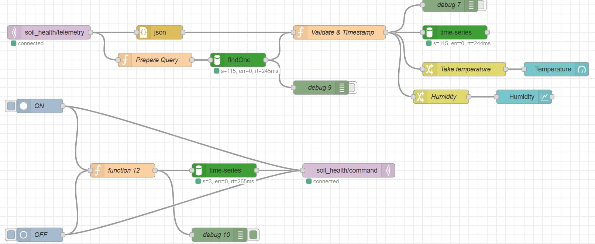

# Edge-Gateway-Climate-Monitoring
IoT Node-RED and ESP32 project for environmental monitoring via local EMQX broke

# AtmosSense IoT: Secure Edge-to-Cloud Climate Gateway 🌡️☁️

An end-to-end cloud IoT deployment system designed for real-time microclimate monitoring. This academic project demonstrates the transition of raw environmental data from an edge microcontroller to structured NoSQL document storage via a secure Cloud Virtual Machine (VM). 

---

## 🛠️ Hardware & Cloud Services

### Hardware (Edge Layer)
* ESP32 Microcontroller (NodeMCU/DevKit)
* DHT11 Temperature & Humidity Sensor
* Jumper Wires & Breadboard

### Cloud & Middleware Services
* **Public Cloud VM (e.g., Azure/AWS):** Hosts the middleware components with configured firewall rules exposing ports 1883 and 1880.
* **EMQX MQTT Broker:** Containerized cloud broker handling secure message queuing with strict client authentication.
* **Node-RED:** Cloud-hosted IoT middleware responsible for data parsing, logical verification, and routing.
* **MongoDB Atlas:** Cloud NoSQL database utilizing a dual-collection schema:
  * `device_metadata`: Stores authorized device configurations for verification.
  * `environment_telemetry`: Optimized time-series collection for high-velocity sensor data.
* **MongoDB Charts:** Real-time executive dashboard for live data visualization.

---

## 📸 System Overview

---

## ⚙️ System Workflow

The architecture operates on a secure bi-directional data pipeline:

### 1. Telemetry Path (Edge to Cloud Database)
1. **Data Acquisition:** The DHT11 sensor reads ambient temperature and humidity, and the ESP32 packages this into a JSON payload.
2. **Secure Publishing:** The ESP32 connects via Wi-Fi and publishes the payload to the Cloud VM's EMQX broker over port 1883 using authenticated credentials.
3. **Middleware Verification:** Node-RED (port 1880) subscribes to the telemetry topic. Before storing the data, it queries the `device_metadata` collection in MongoDB Atlas to verify the ESP32's authorization.
4. **Time-Series Storage:** Once verified, Node-RED routes the JSON payload into the `environment_telemetry` time-series collection using Role-Based Access Control (RBAC) with write-only privileges.
5. **Live Dashboard:** MongoDB Charts pulls data directly from the time-series collection to display a live gauge, historical line graphs, and raw data tables.

### 2. Command Path (Cloud to Edge Control)
1. **Command Initiation:** A command payload is injected via the Node-RED flow to change a physical state (e.g., toggle an LED/Relay).
2. **Message Routing:** Node-RED publishes this instruction to a specific command topic on the EMQX broker.
3. **Hardware Execution:** The ESP32, continuously subscribed to the command topic, receives the instruction and executes the physical state change, demonstrating robust bi-directional communication.

---

## 🚀 Quick Start & Deployment

1. Clone this repository to access the ESP32 C++ firmware (`.ino`) and Node-RED exported flow (`flows.json`).
2. Flash the firmware to your ESP32, ensuring Wi-Fi credentials and the Public Cloud VM IP address are updated.
3. Import `flows.json` into your Cloud Node-RED instance.
4. Configure MongoDB Atlas with the appropriate Database Users (RBAC) and IP Access List to allow connections from your VM.
